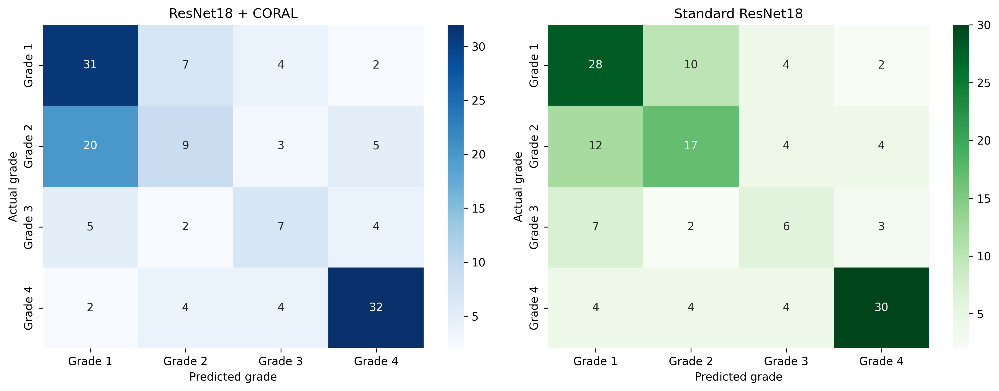

# Diabetic Foot Ulcer Severity Assessment Using Ordinal Deep Learning

An ongoing research project exploring deep learning approaches for four-grade diabetic foot ulcer (DFU) severity assessment using RGB wound images.

The project investigates whether modelling the ordered relationship between severity grades can provide a useful alternative to conventional multiclass classification.

> **Research status:** Ongoing. The current repository contains two evaluated ResNet18 baselines. Results are preliminary and are not clinically validated.

## Research Motivation

DFU image-based assessment is challenging because wound appearance can vary with image framing, lighting, viewing angle, image quality and wound visibility.

Conventional classification treats severity grades as separate categories, despite their natural ordering. This project investigates ordinal learning as an approach that explicitly represents the ordered relationship between the four grades.

*The current numerical experiments do not establish a clinically validated continuous severity score.

## Current Experiments

### 1. ResNet18 with CORAL ordinal regression

- Pretrained ResNet18 feature extractor.
- CORAL ordinal regression head.
- Shared scalar severity score with ordered thresholds.
- Cumulative ordinal targets for four severity grades.
- Binary cross-entropy with logits for ordinal training.

### 2. Standard ResNet18 classification baseline

- Pretrained ResNet18 feature extractor.
- Four-class classification head.
- Cross-entropy training objective.
- Used as a conventional classification baseline for comparison.

### Training configuration

Both experiments used:

| Parameter | Value |
|---|---:|
| Input resolution | 224 × 224 |
| Batch size | 32 |
| Training epochs | 20 |
| Learning rate | 0.0001 |
| Weight decay | 0.0001 |
| Random seed | 42 |
| Optimizer | AdamW |
| Model backbone | ResNet18 |

The best checkpoint for each experiment was selected using validation quadratic weighted kappa (QWK).

## Dataset

The experiments use the four-class DFU image dataset:

[Kaggle — DFU Dataset Annotated into 4 Classes](https://www.kaggle.com/datasets/khalidsiddiqui2003/dfu-dataset-annotated-into-4-classes)

The dataset contains four severity categories:

- Grade 1
- Grade 2
- Grade 3
- Grade 4

The local dataset is not included in this repository. Please obtain it from the original source and follow its terms of use.

The available dataset documentation describes preprocessing and augmented image versions. Patient-level identifiers are not available to this project, so patient-level separation cannot be verified.

## Evaluation Results

Both models were evaluated on the same 141-image test split.

| Metric | ResNet18 + CORAL | Standard ResNet18 |
|---|---:|---:|
| Accuracy | 56.03% | 57.45% |
| Macro precision | 51.92% | 54.17% |
| Macro recall | 52.46% | 53.59% |
| Macro F1 | 51.37% | 53.73% |
| Quadratic weighted kappa | **0.6638** | 0.6052 |

### Interpretation

The standard classifier achieved slightly higher accuracy and macro F1. CORAL achieved a higher quadratic weighted kappa, suggesting better agreement when the ordered nature of the grades is considered.

Neither approach performs consistently best across all metrics. Both models show weaknesses in intermediate severity grades, particularly Grade 3.

The test set is relatively small, with only 18 Grade 3 images. These results should therefore be interpreted cautiously.

### Confusion matrix comparison



## Repository Structure

```text
dfu-severity-assessment/
├── configs/
│   └── configs.yaml
├── results/
│   ├── test_evaluation/
│   ├── classifier_test_evaluation/
│   ├── error_analysis/
│   ├── training_history.csv
│   └── classifier_training_history.csv
├── src/
│   ├── data/
│   ├── evaluation/
│   ├── models/
│   ├── train.py
│   ├── train_classifier.py
│   └── utils.py
├── requirements.txt
├── .gitignore
└── README.md
```

Model checkpoints, the raw dataset and individual test-image predictions are intentionally excluded.

This is the structure of the folder with the downloaded data from the Kaggle Dataset
```text
data/
└── raw/
    ├── train/
    │   ├── Grade 1/
    │   ├── Grade 2/
    │   ├── Grade 3/
    │   └── Grade 4/
    ├── valid/
    │   ├── Grade 1/
    │   ├── Grade 2/
    │   ├── Grade 3/
    │   └── Grade 4/
    └── test/
        ├── Grade 1/
        ├── Grade 2/
        ├── Grade 3/
        └── Grade 4/
```
The reported results were obtained using Google Colab with a Tesla T4 GPU.

## Limitations

- The test set contains only 141 images.
- Grade 3 has particularly limited test representation.
- Patient-level separation cannot be established because patient identifiers are unavailable.
- The two models were trained with one reported random seed; repeated-seed evaluation has not yet been performed.
- Results are exploratory and do not establish clinical reliability.
- No clinician-validated continuous severity ground truth is currently available.
- The current experiments use RGB images only.
- The reported comparison is not an independent confirmatory study of model superiority.

## Future Work

- Conduct systematic error analysis of misclassified images.
- Investigate intermediate-grade confusion and ordinal prediction behaviour.
- Review dataset splitting and potential source-level overlap.
- Investigate wound localization and image-framing effects.
- Explore tissue-composition features while accounting for lighting and acquisition variability.
- Develop and evaluate continuous severity estimation against appropriate clinical annotations.
- Perform repeated-seed experiments and stronger validation.

## Disclaimer

This repository is intended for research and educational purposes only. It is not a medical diagnostic tool and must not be used to make clinical decisions.

## Acknowledgements

The dataset is credited to its original Kaggle contributors. This project uses PyTorch, Torchvision, scikit-learn and other open-source tools.
